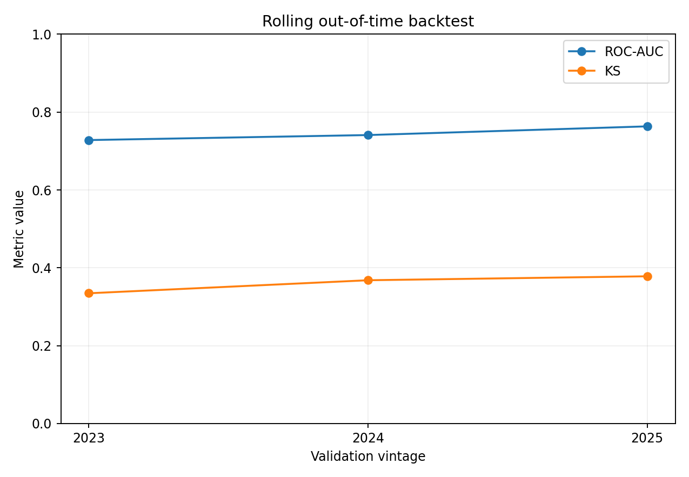
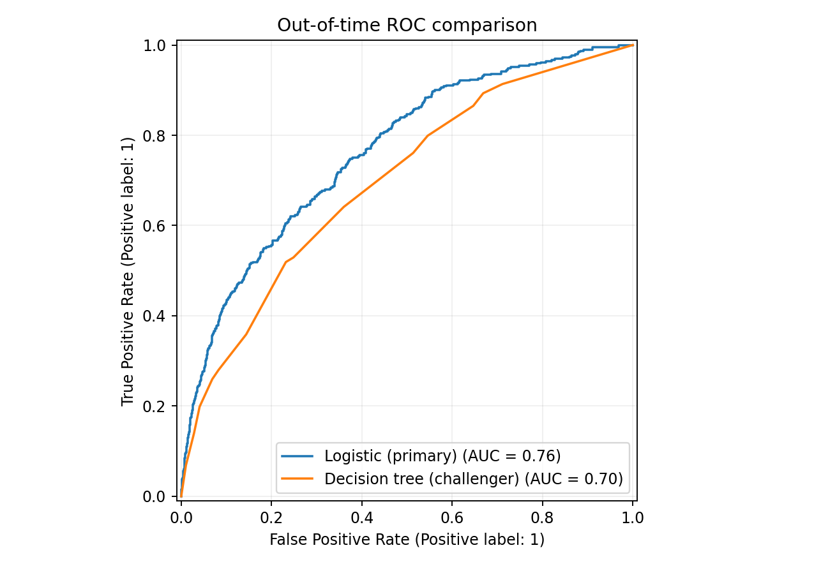
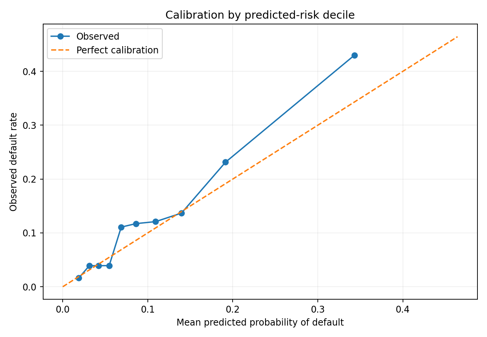
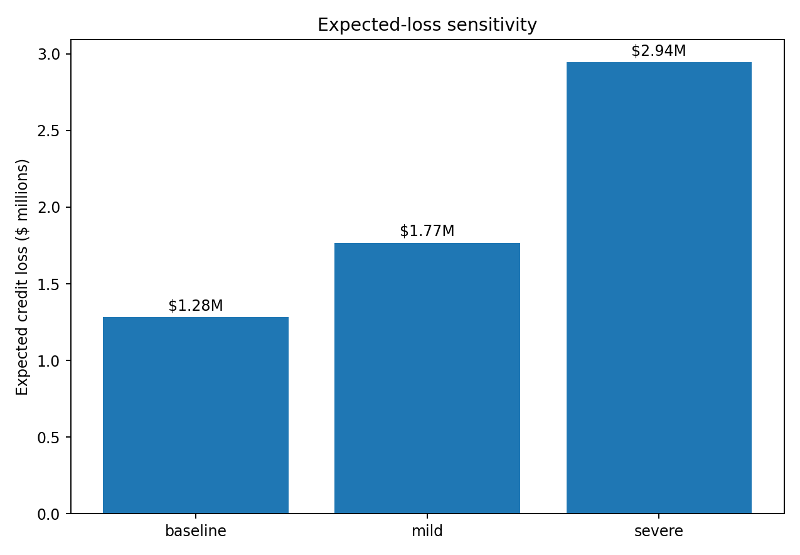

# Credit Risk Model Validation & Stress Testing

> A reproducible model-risk workflow for 12-month probability of default (PD): model development, out-of-time validation, challenger benchmarking, statistical uncertainty, temporal backtesting, stress testing, and expected credit loss translation.


## Executive summary

This project asks a model-risk question rather than only a machine-learning question: **does a simple, interpretable PD model continue to rank and quantify risk on later borrower vintages, and what happens to expected credit loss when borrower conditions deteriorate?**

| Validation signal | Result |
|---|---:|
| 2025 OOT ROC-AUC | **0.763** |
| 95% bootstrap CI for ROC-AUC | **0.739 - 0.789** |
| OOT KS statistic | **0.378** |
| OOT Brier score | **0.098** |
| Primary - challenger AUC | **+0.066** |
| 95% CI for AUC difference | **+0.045 to +0.086** |
| Train-vs-OOT score PSI | **0.003** |
| OOT predicted PD vs observed default | **10.85% vs 12.81%** |
| Baseline expected credit loss | **$1.28M** |
| Severe-stress expected credit loss | **$2.94M (+129.7%)** |

The primary model is a scaled **logistic regression** trained on 2022-2024 observations and validated on the held-out 2025 vintage. A shallow decision tree serves as a challenger. The primary model's AUC advantage remains positive across a paired-bootstrap 95% interval, while the 2025 portfolio still shows a calibration shortfall: predicted PD is below the realized default rate. This creates a realistic model-governance conclusion - useful discrimination does not imply production readiness.

## Why this project is more than a classifier

A conventional portfolio project might stop after `model.fit()` and report accuracy. This repository continues through the parts that matter for risk-management use:

- **Data controls:** reproducible generation plus automated range, uniqueness, missingness and target checks
- **Temporal validation:** 2025 is held out entirely from development
- **Rolling backtests:** each validation year is scored using only information from earlier years
- **Uncertainty:** bootstrap confidence intervals for ROC-AUC, KS and Brier score
- **Benchmarking:** paired-bootstrap comparison against a challenger model
- **Calibration:** predicted PD is compared with realized default by risk decile and at portfolio level
- **Stability:** score-distribution movement is monitored with PSI
- **Governance-aware feature selection:** age is retained in the synthetic dataset for realism but excluded from PD inputs
- **Financial translation:** `Expected Credit Loss = PD x EAD x LGD`
- **Stress sensitivity:** borrower risk drivers and LGD are stressed, then the portfolio is re-scored
- **Reproducibility:** unit tests, CI, notebooks, modular source code and a generated validation report

## Validation design

```text
Synthetic borrower portfolio (2022-2025)
                |
                v
       Automated data controls
                |
                v
       2022-2024 development
        /                 \
       v                   v
Logistic regression    Decision tree
   (primary)           (challenger)
        \                 /
         v               v
         2025 OOT validation
                |
    +-----------+------------+----------------+
    |           |            |                |
    v           v            v                v
Discrimination Calibration Stability   Statistical uncertainty
 AUC / KS      Brier/deciles   PSI      Bootstrap confidence intervals
    |           |            |                |
    +-----------+------------+----------------+
                |
                v
       Rolling vintage backtest
                |
                v
      Stress PD and LGD inputs
                |
                v
      Expected credit loss (ECL)
```

## Rolling out-of-time performance

Each validation vintage is scored by a model trained only on prior years.

| Validation year | ROC-AUC | KS | Brier | Mean predicted PD | Observed default |
|---:|---:|---:|---:|---:|---:|
| 2023 | 0.728 | 0.335 | 0.086 | 11.06% | 10.40% |
| 2024 | 0.741 | 0.368 | 0.089 | 10.76% | 10.93% |
| 2025 | 0.763 | 0.378 | 0.098 | 10.85% | 12.81% |



The latest vintage retains ranking power but exhibits a larger calibration gap. That is intentionally treated as a **monitoring and recalibration issue**, not hidden behind a single headline AUC.

## Challenger-model evidence

The decision tree challenger achieves **0.697 ROC-AUC** on 2025. The primary model's paired-bootstrap AUC advantage is:

> **+0.066, 95% CI [+0.045, +0.086]**

This is stronger evidence than simply comparing two point estimates because the models are evaluated on the same borrowers and the uncertainty in their difference is quantified.



## Calibration

The primary model predicts a **10.85%** average 2025 PD against a **12.81%** observed default rate. Portfolio-level underprediction coexists with acceptable discrimination, illustrating why probability models require calibration review in addition to rank-order metrics.



## Stress testing and expected credit loss

The synthetic portfolio includes exposure at default (EAD) and loss given default (LGD) fields that are **not used as PD predictors**. They are used only to translate model outputs into loss estimates.

`Expected Credit Loss = PD x EAD x LGD`

| Scenario | Mean PD | Mean LGD | Expected loss | Change vs baseline |
|---|---:|---:|---:|---:|
| Baseline | 10.85% | 41.48% | **$1.28M** | - |
| Mild | 13.40% | 46.48% | **$1.77M** | **+37.9%** |
| Severe | 20.29% | 51.48% | **$2.94M** | **+129.7%** |

The scenarios are sensitivity tests, not supervisory or macroeconomic forecasts. The purpose is to show how deteriorating borrower conditions can move both default probability and portfolio loss severity.



## Data controls

The pipeline fails before modelling if core controls fail. Current run: **8/8 checks passed**.

Checks include:

- unique borrower IDs
- no missing values
- valid binary target
- DTI and utilization ranges
- LGD range
- positive EAD

Detailed results: [`outputs/data_quality_checks.csv`](outputs/data_quality_checks.csv)

## Repository structure

```text
credit-risk-model-validation/
|
|-- README.md
|-- MODEL_CARD.md
|-- DATA_DICTIONARY.md
|-- TECHNICAL_NOTES.md
|-- run_analysis.py
|-- run_sql_demo.py
|-- generate_report.py
|-- requirements.txt
|-- Makefile
|
|-- data/
|   `-- credit_portfolio.csv
|
|-- notebooks/
|   |-- 01_data_exploration.ipynb
|   |-- 02_model_development.ipynb
|   |-- 03_model_validation.ipynb
|   `-- 04_stress_testing.ipynb
|
|-- src/
|   |-- data.py
|   |-- model.py
|   |-- validation.py
|   |-- stress.py
|   `-- plots.py
|
|-- sql/
|   `-- risk_analysis.sql
|
|-- outputs/
|   |-- results.json
|   |-- annual_backtest.csv
|   |-- primary_metric_confidence_intervals.csv
|   |-- challenger_auc_difference.csv
|   |-- model_comparison.csv
|   |-- calibration_by_decile.csv
|   |-- stress_test_results.csv
|   |-- data_quality_checks.csv
|   |-- logistic_coefficients.csv
|   `-- figures/
|
|-- reports/
|   `-- model_validation_report.pdf
|
|-- tests/
|   `-- test_project.py
|
`-- .github/workflows/tests.yml
```

## Run locally

```bash
python -m venv .venv
source .venv/bin/activate       # Windows: .venv\Scripts\activate
pip install -r requirements.txt
python run_analysis.py
python run_sql_demo.py
pytest -q
```

Regenerate the PDF report:

```bash
python generate_report.py
```

Or run the core workflow:

```bash
make all
```

## Design rationale

### Why is age excluded from the PD model?

Age is retained only as a synthetic portfolio attribute and is not included in `FEATURES`. For a portfolio demonstration, excluding it avoids turning the project into a legal/fair-lending exercise and keeps the model focused on directly credit-related variables. A production lender would apply its own legal, compliance and fair-lending governance.


### Why logistic regression?

The objective is model judgement rather than algorithm complexity. Logistic regression provides transparent probability estimates and makes it easy to discuss coefficient direction, calibration, temporal performance and stress sensitivity. The decision tree is a benchmark, not an attempt to maximize leaderboard performance.

### Why out-of-time validation?

A random split can place observations from the same environment in both development and test data. Holding out the newest vintage asks a harder and more operationally relevant question: **does a model built on prior portfolios continue to work on a later one?**

### Why bootstrap confidence intervals?

A single AUC or KS value can overstate certainty. Observation-level resampling provides a simple way to quantify uncertainty around headline metrics and around the primary-vs-challenger AUC difference.

### Why expected loss?

PD is useful, but risk decisions ultimately need financial interpretation. Adding EAD and LGD turns the stress test into an estimated loss impact while keeping the PD model itself deliberately simple.

## Model limitations

1. **Synthetic data.** The portfolio is generated from a fixed seed and contains no real borrowers. It demonstrates methodology rather than real-bank performance.
2. **Illustrative EAD/LGD.** Exposure and severity are synthetic and are not calibrated to any real-world bank portfolio.
3. **Illustrative stress assumptions.** Scenarios are sensitivity tests, not regulatory stress paths.
4. **Limited history.** Three rolling validation vintages are useful for demonstration but insufficient for production governance.
5. **No causal claims.** Coefficients describe predictive association, not causal effects.
6. **No fair-lending or regulatory review.** A production credit model would require substantially broader governance, testing, documentation and independent review.

## Documentation

- [`reports/model_validation_report.pdf`](reports/model_validation_report.pdf) - concise validation report
- [`MODEL_CARD.md`](MODEL_CARD.md) - intended use, performance and limitations
- [`DATA_DICTIONARY.md`](DATA_DICTIONARY.md) - field definitions and model roles
- [`TECHNICAL_NOTES.md`](TECHNICAL_NOTES.md) - metric definitions and implementation decisions

## Data note

`data/credit_portfolio.csv` is generated from a fixed random seed by `src/data.py`. It contains **12,000 synthetic observations** and no confidential, proprietary or personally identifiable customer data.

## Disclaimer

Educational portfolio project only. It is not a lending decision system, regulatory model validation, financial advice, or a representation of any bank's data or production models.
